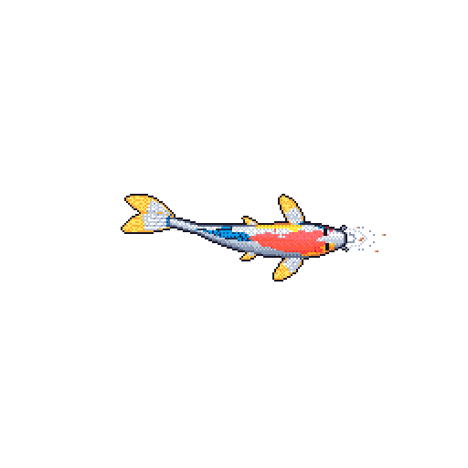

## What's up?
> The ceiling - we don’t touch grass around these parts so we don’t see what's above that.

I'm Beatrice - I like programming, ham radio, and mathematics.

I don't believe in fancy READMEs. I am not a larper.

I am good at:
- Linux
- macOS (so zsh basically)
- C++
- Python
- DS/Algo stuff
- Docker (screw Kubernetes gang)
- Maths (on some levels)
- Critical thinking (AI needs help sometimes)
- Prompting (I need help sometimes)
- HTML/CSS
- Hating Vercel
- Disliking JS/React
- Ham radio (to some extent)
- DevOps (not quite but I am getting there)
- Virtualisation
- Some hardware (the extent is making a small weather station with an ESP32)
- Git (shockingly this is quite a recent skill I have acquired)
- Being patient (very underrated skill)

I am working on three things: mesh networking, getting a radio license, and a startup called [Equilibrium.](equilibrium.ie)

You may see I don’t have much here - GitHub is something I only started to use recently, I keep most things local. I may update some repos from time to time so more people can see that maybe I am not so inactive :D

